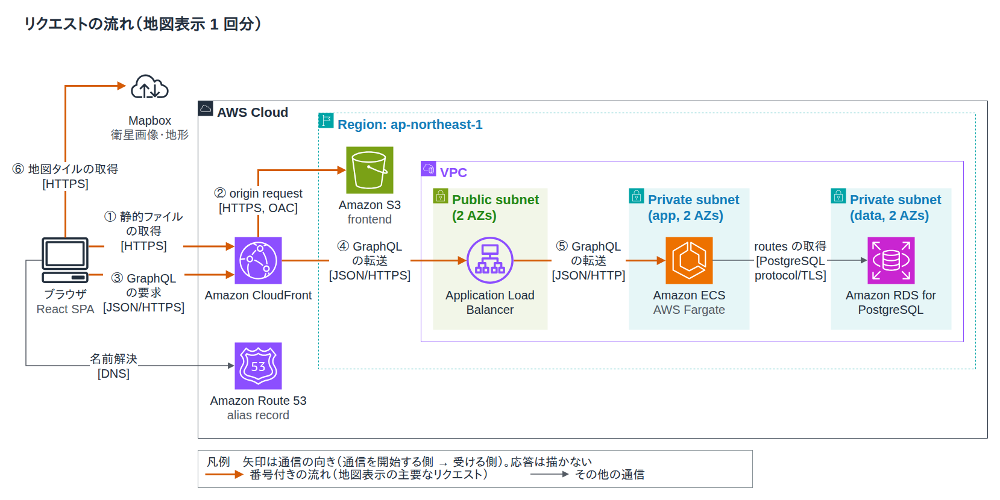
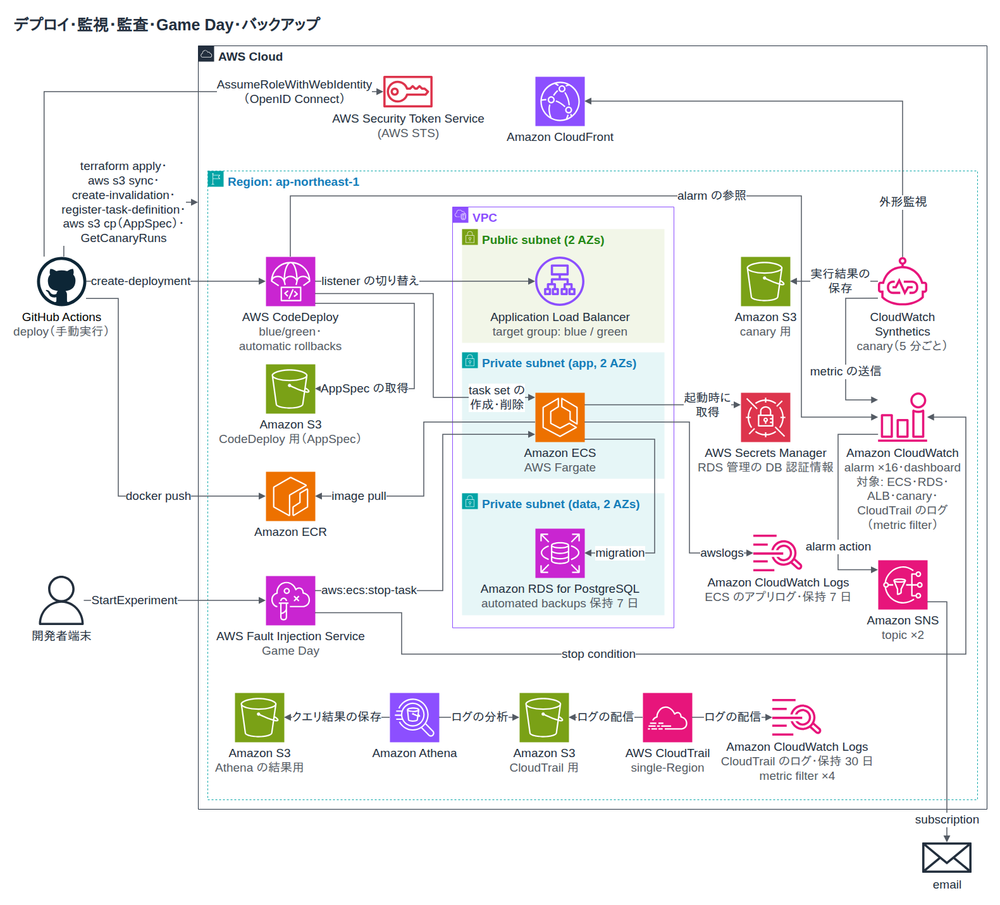
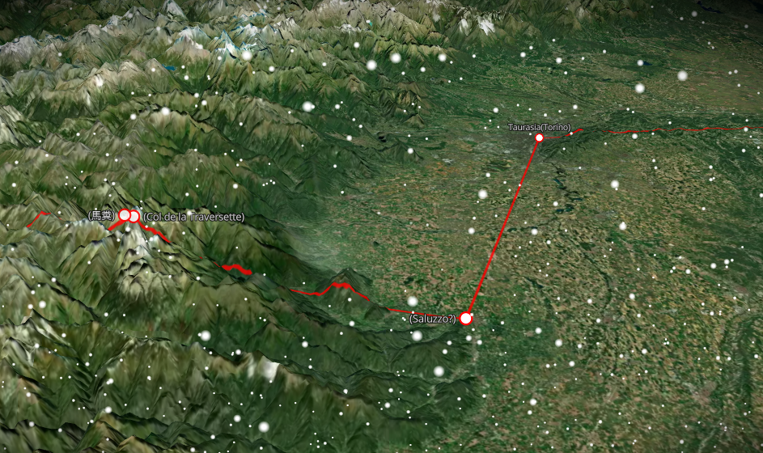

# terraform-hannibal

Terraform / AWS / GitHub Actions を使い、ECS Fargate ベースのアプリケーション基盤と、Issue → Branch → PR → CI → Merge の変更管理ガードレールを構築した DevOps / SRE / Platform Engineering 向けポートフォリオ。

## 採用担当者向けサマリー（30秒）

- **対象ロール**: DevOps Engineer / SRE / Platform Engineer / インフラエンジニア
- **基盤構成**: Terraform で ECS Fargate / ALB / CloudFront / RDS / S3 / Route 53 / CodeDeploy / CloudWatch（alarm・Synthetics）/ SNS / AWS FIS / CloudTrail / Athena を管理
- **CI/CD**: GitHub Actions から provisioning / Blue-Green / Canary / destroy を実行
- **変更管理**: Issue / Branch / PR / Label / CI により、目的・影響範囲・rollback・レビュー観点を追跡
- **ADR**: WAF / GuardDuty / Terraform state locking / IAM Role 分離などの主要な設計判断・採択理由・影響を記録（[docs/adr/README.md](./docs/adr/README.md)）
- **AI Agent 対応**: AI Agent / CLI / GitHub UI 経由の作業でも、人間確認とCIによりレビュー可能な履歴を残す設計
- **セルフサービス運用**: 環境のオンデマンド起動・停止に加え、CloudWatch Alarm / ECS / CodeDeploy / Terraform state / rollback の初動手順と Game Day（AWS FIS）の手順を Runbook として整備
- **コスト設計**: 通常停止運用により、稼働時の月額約 $30-50 から停止時約 $5 まで抑制
- **外部の技術発信**: Terraform / AWS / GitHub Actions / DevOps 周辺の記事を掲載（[https://zenn.dev/kmryst](https://zenn.dev/kmryst)）

## 一番見てほしいポイント

開発者・運用者・AI Agent が安全に変更を流せる Platform / DevOps 基盤の設計。変更の目的・影響・検証・戻し方を追える状態にすることを主眼に置いている。

### 1. AI Agent が関与してもレビュー可能な運用

AI Agent の作業は、実装前の計画提示を運用ルールとし、PR 作成後は Issue link / label / rollback 欄 / CI で機械的に検査する。AI が関与した変更でも意図・判断・差分・検証結果を追跡できる変更管理として設計している。

### 2. 変更管理のガードレール

Issue では `目的` / `対象` / `受け入れ条件` と `type` / `area` / `risk` / `cost` ラベルを必須化。PR では Issue link、必須ラベル、厳密運用時の rollback 欄を `PR Policy Check` で検査する。運用ルールは [CONTRIBUTING.md](./CONTRIBUTING.md)、設計意図は [GitHub Flow Guardrails](./docs/operations/github-flow-guardrails.md) に分離。

### 3. セルフサービス運用と品質ゲート

GitHub Actions から provisioning / Blue-Green / Canary / destroy を実行できる。PR では Terraform fmt/validate、TFLint、Trivy Config、Gitleaks、CodeQL、Dependency Audit を実行し、週次/手動の [Security Scan](./.github/workflows/security-scan.yml) で Trivy dependency/container scan を確認する。

## アーキテクチャ概要

対象は dev 環境（Region: ap-northeast-1）。図の元データ（リソース一覧・接続関係と、それぞれの根拠のファイル）は [inventory](./docs/architecture/diagrams/src/inventory.md) にある。

### リクエストの流れ（地図表示 1 回分）



1. ブラウザが Amazon CloudFront から静的ファイル（index.html・JavaScript）を HTTPS で取得する。名前解決では Amazon Route 53 の alias record が CloudFront を返す。HTTP は HTTPS へ redirect する
2. CloudFront は cache miss のとき、Amazon S3 の frontend 用 bucket へ origin request を送る。S3 へのアクセスは origin access control（OAC）で署名し、bucket policy で読み取りをこの distribution だけに限定している
3. 画面の表示時に、React SPA（Apollo Client）が同一オリジンの `/graphql` へ GraphQL query `GetMapData`（首都・ハンニバルの進軍ルート・地点）を送る
4. CloudFront は `/graphql` を Application Load Balancer（ALB）へ HTTPS で転送する（キャッシュしない）。ALB は CloudFront からのアクセスだけを受ける。ALB の security group は CloudFront の origin-facing managed prefix list からの通信だけを許可し、さらに CloudFront が付ける custom header が一致しないリクエストには listener rule が 403 を返す（[ADR 0004](./docs/adr/0004-keep-internet-facing-alb-with-cloudfront-origin-controls.md)）
5. ALB は private subnet（app）の Amazon ECS（AWS Fargate）の task へ HTTP で転送する。NestJS の resolver はアプリに同梱した GeoJSON を返すため、地図表示の GraphQL は DB を通らない
6. GraphQL の結果が届いた後、ブラウザの Mapbox GL JS が Mapbox から地図タイル（衛星画像・地形）と style を取得し、地図を描く

番号の無い ECS → Amazon RDS for PostgreSQL の線は、GraphQL query `routes`（Synthetics canary とテストが使う）と、ECS task の起動時の TypeORM migration の通信。RDS は private subnet（data）にあり、security group で ECS からの接続だけを受ける。data subnet の route table にはデフォルトルートが無く、外へ出ない。

### デプロイ・監視・監査・Game Day・バックアップ



- **デプロイ**: GitHub Actions の `deploy.yml` を手動実行する。OpenID Connect で AWS Security Token Service（AWS STS）の `AssumeRoleWithWebIdentity` を呼び、一時認証情報で `terraform apply`（network → database → service → observability → cdn）を実行する。続けて frontend を S3 へ同期して CloudFront のキャッシュを無効化し、コンテナイメージを Amazon ECR へ push して ECS の task definition を登録する。`bluegreen` / `canary` モードでは、AWS CodeDeploy が AppSpec file を S3 から読み、ECS の task set を作成・削除して ALB の listener の転送先（target group: blue / green）を切り替える。CodeDeploy はデプロイの失敗、または ALB の 5XX・応答時間の CloudWatch alarm で automatic rollback する。最後に Synthetics canary の実行結果を確認する
- **監視**: Amazon CloudWatch alarm は 16 個（ECS・RDS・ALB の SLO burn rate・CodeDeploy 用・Synthetics canary の 12 個と、CloudTrail のログの metric filter に対する 4 個）と dashboard。alarm action は Amazon SNS の topic（2 個）で、email へ通知する。Amazon CloudWatch Synthetics の canary が 5 分ごとに CloudFront 経由で frontend → `/health` → GraphQL（`capitalCities`・`routes`）を確認する
- **監査**: AWS CloudTrail の trail（single-Region: ap-northeast-1）のログを S3（365 日で失効）と CloudWatch Logs（保持 30 日）に配信する。S3 のログは Amazon Athena で分析し、CloudWatch Logs には metric filter 4 個を設定している。監査系は `terraform/foundation` の管理で、destroy 後も残る
- **Game Day**: 開発者端末から AWS Fault Injection Service（AWS FIS）の実験を開始し、ECS の task を停止する。SLO の error rate の alarm を stop condition にしている（[ADR 0028](./docs/adr/0028-fis-game-day-ecs-task-stop-experiment-design.md)、[ADR 0029](./docs/adr/0029-separate-fis-observability-root-module-for-blast-radius.md)）
- **バックアップ**: RDS の automated backups（保持 7 日）。dev 環境は final DB snapshot を取らず、deletion protection も無効（通常停止の運用のため）
- **その他**: DB の認証情報は RDS が管理する AWS Secrets Manager の secret で、ECS の task の起動時に注入する。アプリのログは Amazon CloudWatch Logs（保持 7 日）

図に描いていないもの:

- コストの通知は AWS Budgets（月額の budget と email 通知）
- ECS task から ECR・Secrets Manager・CloudWatch Logs の API への通信は NAT gateway を通る（dev は 1 台を 2 AZ で共用。VPC endpoint は無い）
- TLS 証明書は AWS Certificate Manager（ACM）。CloudFront 用は us-east-1、ALB 用は ap-northeast-1
- Terraform の state は S3 backend（S3 lockfile でロック）

| 略語・図中の語 | 正式名 |
| --- | --- |
| OAC | origin access control（Amazon CloudFront） |
| ALB | Application Load Balancer（Elastic Load Balancing） |
| SPA | single-page application |
| Amazon ECS | Amazon Elastic Container Service |
| Amazon ECR | Amazon Elastic Container Registry |
| Amazon RDS | Amazon Relational Database Service |
| Amazon S3 | Amazon Simple Storage Service |
| Amazon SNS | Amazon Simple Notification Service |
| AWS STS | AWS Security Token Service |
| AWS FIS | AWS Fault Injection Service |
| AppSpec | AppSpec file（AWS CodeDeploy の application specification file） |
| `awslogs` | Amazon ECS の awslogs log driver |
| SLO | service level objective |

詳細な構成は [Architecture Docs](./docs/architecture/) と [Terraform Modules](./docs/architecture/terraform-modules.md) を参照。図の作り方は [Architecture Diagram History](./docs/architecture/diagram-automation-history.md) を参照。

## GitHub運用と品質ゲート

| 領域 | 実装内容 | 証跡 |
|---|---|---|
| Issue | 最小本文項目と必須ラベルを検査 | [Issue Form](./.github/ISSUE_TEMPLATE/feature_request.yml) |
| PR | Issue link、必須ラベル、rollback 欄を検査 | [PR template](./.github/pull_request_template.md) |
| Policy | 軽運用 / 厳密運用を判定 | [pr-policy-check.yml](./.github/workflows/pr-policy-check.yml) |
| Commit | PR title とコミットメッセージを Conventional Commits で統一 | [CONTRIBUTING.md](./CONTRIBUTING.md) |
| IaC | Terraform fmt/validate、TFLint（PR Terraform plan artifact は [#410](https://github.com/kmryst/terraform-hannibal/issues/410) で一時停止中） | [Quality Gates](./docs/operations/quality-gates.md) |
| Security | Trivy Config、Gitleaks、CodeQL、Dependency Audit、Trivy dependency/container scan | [Quality Gates](./docs/operations/quality-gates.md) / [Security Design](./docs/architecture/security-design.md) |

Trivy Config の検出結果は初期導入時点では review signal として扱い、即時修正・accepted risk・後続検討に分けて Issue 化している（例: [#231](https://github.com/kmryst/terraform-hannibal/issues/231), [#233](https://github.com/kmryst/terraform-hannibal/issues/233)）。

## CI/CD と運用

| Workflow | 役割 |
|---|---|
| [deploy.yml](./.github/workflows/deploy.yml) | `provisioning` / `bluegreen` / `canary` を手動選択し、PR gate 通過済みの `main` から Terraform apply、frontend の S3 同期と CloudFront の invalidation、ECR への push、CodeDeploy、Synthetics canary の確認を実行（`provisioning` は CodeDeploy を使わない） |
| [destroy.yml](./.github/workflows/destroy.yml) | 利用終了後に `DESTROY` 入力で一時リソース（ECS / RDS / ALB などアプリ実行系）を停止・削除 |
| [pr-check.yml](./.github/workflows/pr-check.yml) | backend の lint・build・test、frontend の build・test、Docker build と smoke test、ShellCheck、Hadolint、Terraform fmt/validate、TFLint、Trivy Config |
| [pr-policy-check.yml](./.github/workflows/pr-policy-check.yml) / [pr-commitlint.yml](./.github/workflows/pr-commitlint.yml) | PR policy（Issue link・必須ラベル・rollback 欄）、PR title とコミットメッセージの commitlint |
| [gitleaks-secret-scan.yml](./.github/workflows/gitleaks-secret-scan.yml) | PR の secret 混入検出 |
| [codeql.yml](./.github/workflows/codeql.yml) | PR・`main` への push・週次の CodeQL |
| [dependency-audit.yml](./.github/workflows/dependency-audit.yml) | PR・週次の npm 依存の脆弱性検査 |
| [security-scan.yml](./.github/workflows/security-scan.yml) | 週次/手動の Trivy dependency scan、container scan |
| [markdown-lint.yml](./.github/workflows/markdown-lint.yml) / [toolchain-version-check.yml](./.github/workflows/toolchain-version-check.yml) | PR の Markdown lint、Terraform などのツールのバージョンの一致の検査 |
| [issue-template-check.yml](./.github/workflows/issue-template-check.yml) | Issue の必須見出しと必須ラベルの検査 |
| [sync-labels.yml](./.github/workflows/sync-labels.yml) | `.github/labels.yml` を GitHub labels に同期 |

`deploy.yml` は backend/frontend test を再実行しない。コード品質の確認は PR gate（`pr-check.yml` ほか）に一本化し、deploy workflow は `main` からの手動デプロイに集中させる。
`security-scan.yml` は毎週月曜 00:15 UTC（09:15 JST）と手動実行で動かす。PR ごとの軽量 gate は `pr-check.yml` に寄せ、Docker image の Trivy scan などの重めの scan は定期監査として GitHub Security に残す。CodeQL は `codeql.yml` で PR・`main`・週次に実行する。

Blue/Green / Canary の詳細は [CodeDeploy Blue/Green](./docs/deployment/codedeploy-blue-green.md) を参照。

## セキュリティとコスト設計

| 観点 | 設計 |
|---|---|
| IAM | Permission Boundary + GitHub OIDC AssumeRole で自動化権限を制御 |
| Network | 3層 VPC、private subnet 上の ECS / RDS、DB 層は外部非公開 |
| Audit | CloudTrail を S3 に集約し、Athena で監査ログを分析 |
| Secrets | Gitleaks で secret 混入を PR 時に検出 |
| IaC security | Trivy Config で Terraform / Dockerfile の設定ミスを review signal として検出 |
| Cost | 環境を通常停止し、必要時だけ起動する運用で固定費を抑制。コスト前提は [Operations Docs](./docs/operations/README.md) に記録 |
| Accepted risk | WAF / GuardDuty などコスト影響が大きい機能は、showcase 用途・外部公開範囲・コスト影響・再検討条件を [Security Design](./docs/architecture/security-design.md) に残す方針 |

IAM / OIDC / Permission Boundary の詳細は [IAM Management](./docs/operations/iam-management.md) と [PR Terraform Plan Role Design](./docs/operations/pr-terraform-plan-role-design.md) を参照。主要な設計判断の根拠は ADR（[docs/adr/README.md](./docs/adr/README.md)）に記録。

## デモと証跡

この環境はコスト抑制のため通常停止。必要時は GitHub Actions から provisioning / deploy / destroy を実行でき、起動前でも docs / Actions / Issues / PRs から設計意図と運用履歴を確認できる。

- デモURL: [hamilcar-hannibal.click](https://hamilcar-hannibal.click)（通常停止中）

### アプリ画面（停止中のため参考スクリーンショット）

<div align="center">
  
</div>

動作の様子は [docs/screenshots/hannibal_1_middle.gif](docs/screenshots/hannibal_1_middle.gif) を参照。

- 起動: [deploy.yml](./.github/workflows/deploy.yml) の `provisioning` / `bluegreen` / `canary`
- 停止: [destroy.yml](./.github/workflows/destroy.yml) の `DESTROY` 確認付き workflow
- 構成図: [docs/architecture/diagrams/](./docs/architecture/diagrams/)
- セキュリティ・IAM: [Security Design](./docs/architecture/security-design.md) / [IAM Analysis](./docs/security/iam-analysis/README.md)
- トラブルシュート: [docs/troubleshooting/README.md](./docs/troubleshooting/README.md)

## 代表的な改善と学び

Issue / PR / Label / CI のガードレール整備後から、面接で深掘りしやすい実例を抜粋。詳細な問題・対応・結果は [Quality Gates](./docs/operations/quality-gates.md)、[GitHub Flow Guardrails](./docs/operations/github-flow-guardrails.md)、[Troubleshooting](./docs/troubleshooting/README.md) を参照。

- **Issue / PR / Label / CI のガードレール整備**<br>
  任意運用 → type / area / risk / cost、Issue link、rollback 欄を PR Policy Check で機械的に検査（例: [#92](https://github.com/kmryst/terraform-hannibal/issues/92), [#93](https://github.com/kmryst/terraform-hannibal/pull/93)）
- **PR Terraform plan レビュー基盤の追加**<br>
  deploy / apply 用 role 共用 → pull_request context 限定の PR plan 専用 role（HannibalPRPlanRole-Dev）を新設し、plan artifact・Job Summary・危険シグナル抽出で差分・影響範囲をレビュー可能にした（例: [#121](https://github.com/kmryst/terraform-hannibal/issues/121), [#135](https://github.com/kmryst/terraform-hannibal/pull/135)）。state 分割後は destroy 済みの通常運用で plan が成立しないため、PR plan は [#410](https://github.com/kmryst/terraform-hannibal/issues/410) で一時停止中
- **AI Agent 作業の履歴品質改善**<br>
  明文化なし → 実装前計画提示と Conventional Commits 遵守を CONTRIBUTING.md / CLAUDE.md に明文化し、AI Agent が生成した変更でも PR title・コミットメッセージ・実装前計画を同じ基準で確認できるようにした（例: [#152](https://github.com/kmryst/terraform-hannibal/issues/152), [#200](https://github.com/kmryst/terraform-hannibal/issues/200)）
- **IaC security scan 導入と Trivy 検出の棚卸し**<br>
  PR CI に lint / scan なし → TFLint / Trivy Config / Gitleaks を PR CI に統合し、検出結果を修正対象・accepted risk・後続検討に分類して Issue 化した（例: [#226](https://github.com/kmryst/terraform-hannibal/issues/226), [#227](https://github.com/kmryst/terraform-hannibal/pull/227)）
- **IAM / OIDC 権限の段階的な最小権限化**<br>
  deploy / plan の権限混在 → role 分離と Permission Boundary により、用途ごとの権限範囲を分けて blast radius を抑制（例: [#129](https://github.com/kmryst/terraform-hannibal/issues/129), [#179](https://github.com/kmryst/terraform-hannibal/pull/179)）

## 技術スタック

### Primary stack

| 領域 | 技術 |
|---|---|
| IaC | Terraform 1.14.8 |
| AWS | ECS Fargate、ALB、CloudFront、RDS PostgreSQL、S3、Route 53、ECR、Secrets Manager、CodeDeploy、CloudWatch（alarm・Logs・Synthetics）、SNS、AWS FIS、CloudTrail、Athena |
| CI/CD | GitHub Actions、CodeDeploy Blue/Green、Canary deployment |
| Identity / Security | IAM、OIDC、Permission Boundary、TFLint、Trivy、Gitleaks、CodeQL |
| Operations | Issue Forms、PR template、label policy、required checks、deploy / destroy workflows |

### Application used as deployment target

| 領域 | 技術 |
|---|---|
| Backend | NestJS、TypeScript、GraphQL、PostgreSQL |
| Frontend | React、Vite、Apollo Client、Mapbox GL JS |

## ローカル開発ツール

このリポジトリの主要ツールは `.mise.toml` で管理します。

```bash
mise install
pre-commit install
```

`mise install` は Terraform、Node.js、pre-commit、terraform-docs、TFLint のバージョンを揃えます。
Terraform root module の README は terraform-docs により pre-commit で更新します。

## 詳細ドキュメント

- [CONTRIBUTING.md](./CONTRIBUTING.md) / [GitHub Flow Guardrails](./docs/operations/github-flow-guardrails.md): GitHub運用ルールと設計意図
- [Terraform Runbook](./docs/operations/terraform-runbook.md) / [Terraform Rollback Plan](./docs/operations/rollback-plan.md): Terraform 運用手順、state lock、import、drift 確認、state 復元
- [Quality Gates](./docs/operations/quality-gates.md): PR 品質ゲートとセキュリティチェック
- [IAM Management](./docs/operations/iam-management.md) / [PR Terraform Plan Role Design](./docs/operations/pr-terraform-plan-role-design.md): IAM / OIDC / Permission Boundary
- [CodeDeploy Blue/Green](./docs/deployment/codedeploy-blue-green.md): 無停止切替と段階配信
- [Architecture Docs](./docs/architecture/) / [Security Design](./docs/architecture/security-design.md): システム構成とセキュリティ設計
- [ADR](./docs/adr/README.md): 主要な設計判断・採択理由・影響の記録
- [Troubleshooting](./docs/troubleshooting/README.md): 実装時の課題と解決

---

**最終更新**: 2026年11月14日 JST
